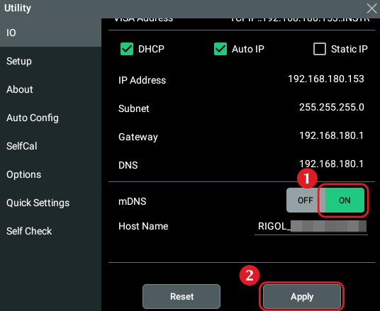

# pymhoscope

**Small Python package to capture data from the Rigol MHO900 series**
**mixed-signal oscilloscopes via SCPI.**

The defining feature of this package is that it supports reading the logic
analyser data remotely. Logic analyser data is not accessible through the
`:WAV:DATA?` SCPI command. Instead, the only way to efficiently access the logic
analyser data is by saving `.bin` files. To automate this, this package
implements a tiny Python SMB1 server (by default running on a random,
unprivilleged port), instructs the scope to connect to that
server, and then receives SMB data as it is written to the virtual SMB
filesystem. SMB transfers also have the advantage that they are faster: they
reach 8 MB/s whereas SCPI transfers reach only about 1.5 MB/s; `pymhoscope`
automatically selects SMB transfers (even when the logic analyser is not active)
when they are faster despite the overhead of setting up an SMB connection.

> [!CAUTION]
> The MHO900 series firmware `00.01.00 build 2026/05/08` has a bug where the
> saving logic analyser data as a `*.csv` or `*.bin` file results in scrambled
> data in the saved file. At least the `*.bin` case can be fixed by swapping a
> single instruction in `libscope-auklet.so`. See the
> [report](docs/mho900_la_save_bug/report.md) for more detail.
>
> Run
> [`patch_mho_la_save.py`](scripts/patch_mho_la_save.py)
> to fix the issue for `*.bin` dumps until the next restart. Pass
> `--permanent` as a command line parameter to patch the installed application
> permanently (up to the next firmware update).

## Installation

```sh
pip install -e <path to `pymhoscope`>
# - or, when using `uv` -
uv pip install -e <path to `pymhoscope`>
```

This package has the following dependencies:

* `numpy` to hold the returned data.
* `zeroconf` for scope auto-discovery.

> [!NOTE]
> _pymhoscope_ uses raw SCPI instead of VXI-11; SCPI seems to be a
> little more stable, whereas VXI-11 resulted in hangs. Correspondingly,
> this library doesn't use the `pyvisa` package. RAW SCPI is simple enough to be
> implemented in a few lines.

## mDNS Auto Discovery

_pymhoscope_ is able to automatically discover an MHO900 scope on the network.
For this to work, activate mDNS in the MHO900 "Utility" menu (tapping the
clock will bring it up). Don't forget to scroll down and press "Apply"; it's not
obvious that this menu is scrollable and that the button exists.

> [!IMPORTANT]
> This setting is not permanent; you need to re-enable mDNS after every reboot.



## SMB Server Port Injection

By default, _pymhoscope_ injects extra options into the `mount -t cifs`
command executed by the scope. Those options instruct it to connect to SMB on a
random unprivileged port.

Just in case an oscilloscope firmware update breaks this unducomented feature,
pass `inject_mount_options=False` to the `MHO900` constructor. The server will
then use port 445. That means that there must be no other SMB server running on
the host machine, and port 445 must be marked as "unprivileged" and allowed by
the firewall.

Note that running a custom server on port 445 does not work on Windows. On Linux
(tested on Fedora Workstation), run the following commands to make port 445
unprivileged and to allow connections to port 445:

```sh
sudo sysctl -w net.ipv4.ip_unprivileged_port_start=445
sudo firewall-cmd --add-service=samba
```

Note that neither the `sysctl` nor the `firewall-cmd` command make permanent
changes to the system. These commands must be re-executed after every boot.

## Usage

The following example captures CH1 and D0 from the scope found via mDNS after
a forced trigger.

```python
import logging

import pymhoscope as mho

logging.basicConfig(level=logging.INFO)

with mho.MHO900() as scope:  # Finds the scope via mDNS; or pass its address
    print(scope.identify())
    scope.reset()
    # All `configure_*` methods return the settings applied by the scope.
    print(
        scope.configure_horizontal(
            min_n_samples=1_000_000,
            min_sample_rate=4e9,
            t_offset=1e-6,
        )
    )
    scope.configure_analogue_channel(
        mho.AnalogueChannel(0),
        enabled=True,
        scale=0.5,
        offset=-1.65,
        probe_scale=10.0,
        bandwidth=mho.Bandwidth.MAX,
        coupling=mho.Coupling.DC,
    )
    scope.configure_digital_channel(
        mho.DigitalChannel(0),
        enabled=True,
        label="D0",
        threshold=1.65,
    )
    scope.configure_edge_trigger(mho.DigitalChannel(0), edge=mho.Edge.RISING)
    scope.arm()
    # Apply the stimulus here; this example forces a trigger instead.
    scope.force_trigger()
    capture = scope.capture()

ch1 = capture.analogue_channels[mho.AnalogueChannel(0)]
print(ch1.data, ch1.t_base, ch1.t_inc)
if capture.digital_waveform is not None:
    print(capture.digital_waveform.data & 1)  # D0
```

All errors raised by the scope derive from `pymhoscope.MHOScopeError`.

## Development

Run `./check.sh` to format, lint (`ruff`), and typecheck (`ty`):

```sh
./check.sh
```

## LLM Usage Disclaimer

I designed and documented the API of this library, and also wrote most of the
code myself except for `mho900.py` and `smb.py`. Those files were mostly written
by Claude Code with Opus 5.5. Claude Code also wrote the patch script for the
logic analyser readout bug.

## Licence

This package is licensed under the AGPLv3 (see `LICENSE`).
