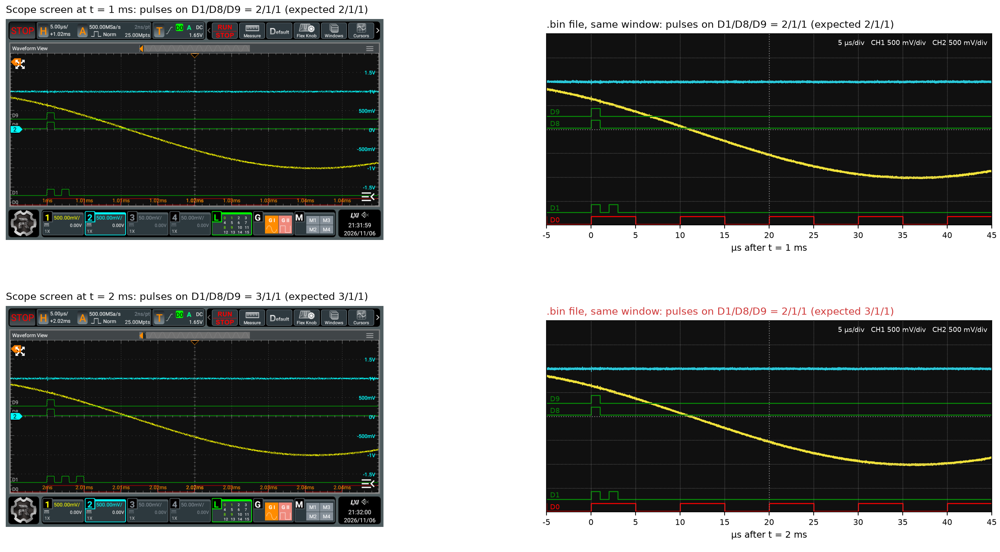

# Rigol MHO900 Series Logic Analyser Save Bug

**Logic analyser data saved to .bin file on Rigol MHO900 series oscilloscopes**
**is corrupted when two or fewer analogue channels are active.**

The Rigol MHO900 series oscilloscopes can save captured data to `.bin` and
`.csv` files. If a logic analyser probe is connected and enabled, the logic
analyser data is stored in those file as well.

Unfortunately, the stored logic analyser is corrupted whenever fewer than three
analogue channels are enabled. For example, when two analogue channels are
active, this affects all logic analyser samples beyond sample index 500,000.
With zero or one analogue channels, `.bin` dumps are already corrupted beyond
250,000 samples. With three or four analogue channels, `.bin` dumps are fine.

I provide a script that automatically fixes the bug (for `.bin` files only) on a
network-connected scope from a Linux machine in
[`patch_mho_la_save.py`](../scripts/patch_mho_la_save.py). Read on for a
detailed description of what is going wrong.

> [!NOTE]
> This description is for the `00.01.00 build 2026/05/08` firmware on a Rigol
> MHO984. Although this report and analysis focus on the `.bin` exports, `.csv`
> exports are similarly corrupted, but with different chunk sizes compared to
> what is reported below. The fix provided in this repository does _not_ fix
> the issue with `.csv` files.

## Reproducing the Bug

1. Feed a known, non-repeating reference signal into the logic analyser probe.
   Enable two analogue channels (with zero or one channels, the bug occurs as
   well, just at different positions; with three or four channels, it does
   not occur at all).
2. Set the sample rate to 500 MSa/s and the memory depth to more than one
   million points, so that the record contains more than 500,000 logic
   analyser samples.
3. Capture the signal.
4. In the menu on the oscilloscope, navigate to `Storage > Save`. There,
   select `Choose > Save Wave` and `Data Source > Memory` as well as
   `Format > *.bin`.
5. Tap "Save".
6. Copy the saved file onto a computer; compare the recorded data to the
   reference signal. For `.bin` saves, all samples beyond 500,000 will be
   corrupted. Individual blocks of the data are still intact, but blocks
   are repeated and the recording does not contain data from the second half
   of the captured range. The capture still has the expected length.

## Example

The following capture with two active analogue channels demonstrates that the
stored data is corrupted.

In the first row, at `t = 1 ms`, data is fully intact; channel `D1` shows two
pulses where two pulses are in the reference data fed into the scope. At
`t = 2 ms` however, the logic analyser channel `D1` clearly shows three pulses
on the display (which matches the reference signal), but in the `.bin` file that
location just contains a copy of what we saw one millisecond earlier.



## Technical Detail and Fix

The following is a best-effort analysis of the issue. I assembled it with
some help from Claude Code with Opus 4.8 and Opus 5.5 (the latter refused to
touch Ghidra). The end result is a one-instruction patch that fixes this issue.

### The Culprit

Looking at the corrupted data in detail, one finds that the data appears to be
"shingled". What I mean by that is that with two analogue channels, data from
250,000 samples earlier is repeated after 500,000 samples. Afterwards, every
block of 250,000 samples is stored twice in the file.

The following illustration depicts this more clearly. The coloured blocks at the
top are the correct captured data as it should appear in the logic analyser
memory (after all, the data is displayed correctly on screen), whereas the
blocks at the bottom show what the data ultimately looks like in the `*.bin`
file.


With zero or one analogue channels, the shingles overlap even more: blocks of
250,000 samples overlap by three quarters. With three or four channels, there
is no overlap at all, and the data is correct.

This starts to make sense when we consider that the logic analyser sample
rate is not always equal to the sample rate displayed by the scope. Instead, the
logic analyser rate is coupled to the ADC clock frequency, which depends on the
number of "virtual 1 GSa/s ADC blocks" assigned to each analogue channel [^1].
The scope apparently tries to minimize the ADC clock by assigning as many
virtual blocks per channel as possible.

| Channels | Displayed sample rate | Logic analyser sample rate | Ratio | Virtual blocks per channel |
| -------- | --------------------- | -------------------------- | ----- | -------------------------- |
| 0        | 1 GSa/s               | 250 MSa/s                  | 1/4   | (4)                        |
| 1        | 1 GSa/s               | 250 MSa/s                  | 1/4   | 4                          |
| 2        | 1 GSa/s               | 500 MSa/s                  | 1/2   | 2                          |
| 3        | 1 GSa/s               | 1 GSa/s                    | 1/1   | 1                          |
| 4        | 1 GSa/s               | 1 GSa/s                    | 1/1   | 1                          |

As I describe in more detail below, the bug in the code likely boils down to the
FPGA always expecting the start offset of a memory transfer to be in terms of
the "displayed units", whereas the code incorrectly programs the FPGA to use
the "logic analyser units".


[^1]: The term "virtual ADC block" is my invention. As far as I can tell,
there are two physical 2 GSa/s ADCs on the board (see
https://www.flickr.com/photos/eevblog/54892379847/). By "virtual ADC block" I
refer to the fact that each ADC chip can be split into two ADCs. That is
how four channels can be served by just two physical ADC chips, and conversely,
how the single channel reaches 4 GSa/s by merging all four "virtual ADCs"
running at 1 GSa/s.


### Debugging Process

> [!NOTE]
> Kudos to Rigol for leaving the `adb` debug interface (port 55555) on
> their instruments completely open and providing root access to their
> customers! It would be great if more companies would do that!

After attaching `strace` to the running scope application and following the
file writes, I found that `libscope-auklet.so` is responsible for communicating
with the FPGA on the scope and for producing the file dumps. Thanks to the
partial debug data left in the binary, one can quickly determine that the
following functions are involved in generating the `.bin` file:

```
CWaveFile::saveBIN
  -> CWaveFile::saveMemAsBin
       -> DrvWaveform_ExportData
            -> CDrvScope::ExportData
                 -> DevAcquireSPU_SetWaveRange
                 -> DevAcquireSpu_SetTxInfo
                 -> DevAnalyzeTrace_Read
  -> CBinFile::writeWaveData
```

`DevAcquireSPU_SetWaveRange` configures registers in the FPGA gateware that
are mapped into system memory through PCIe. Those registers seem to describe a
transfer length (register `0x1100`) and a start offset (register `0x1108`).
For example, with two analogue channels, a `.bin` file with a memory depth of
10 Mpts contains 5,000,000 logic analyser samples, which are transferred in ten
chunks of 500,000 samples. After writing the file, the start offset encodes a
value of 4,500,000 samples.

Superficially, that looks correct: the last of ten 500,000-sample chunks starts
at sample 4,500,000; but in the file the last chunk actually starts at sample
2,250,000 (nine steps of 250,000 samples). Apparently, the FPGA interprets the
start offset in units of displayed/analogue samples, not logic analyser samples.
If that were true, the start offset should have been 9,000,000, since with two
analogue channels, each logic analyser sample spans two analogue samples.

Going up the call stack, `saveMemAsBin` computes the start offset as
```
startOffset = (chunk_idx * 1_000_000 >> 2) * chanMode
```

At this point in the code, `chanMode` is set as follows:

| Channels | `chanMode` | Corruption |
| -------- | ---------- | ---------- |
| 0        | 1          | Yes        |
| 1        | 1          | Yes        |
| 2        | 2          | Yes        |
| 3        | 4          | No         |
| 4        | 4          | No         |

Note that `chanMode` is just four multiplied by the ratio from the table above.
So dividing by four (`>> 2`) and multiplying by `chanMode` converts the
fixed chunk size of one million into the logic analyser sample count:
```
logicAnalyserSamples = analogueSamples * ratio
                     = analogueSamples * (chanMode / 4)
                     = analogueSamples / 4 * chanMode
```

But according to our theory, the FPGA start register is always programmed in
terms of analogue/displayed samples! So the equation should just be:
```
startOffset = chunk_idx * 1_000_000
```
Since `/ 4 * 4` cancels out, the code works for `chanMode = 4`.

We thus need to get rid of the multiplication with `chanMode`. We can do this
by replacing the single instruction
```asm
mul w0, w8, w9  ; w0 = startOffset, w8 = chunk_idx * 1_000_000 >> 2, w9 = chanMode
```
with
```asm
lsl w0, w8, #2  ; w0 = startOffset, w8 = chunk_idx * 1_000_000 >> 2
```
This turns the start offset into `(chunk_idx * 1_000_000 >> 2) << 2`, i.e.,
`chunk_idx * 1_000_000`.

Indeed, with this fix, data written to the `.bin` files is now correct for every
number of analogue channels!

See [`patch_mho_la_save.py`](../../scripts/patch_mho_la_save.py) for
a script that automatically applies this fix to a running oscilloscope.
